<div align="center">

# Akari 明かり

**A fast, modern home screen for Android TV and Google TV, built around what you watch.**

Continue Watching, Upcoming and your lists from Trakt, Simkl, MDBList or your Nuvio account, with logos, ratings and
synopses in a hero at the top, and everything opening straight in your player app.

[Download the latest release](../../releases/latest)

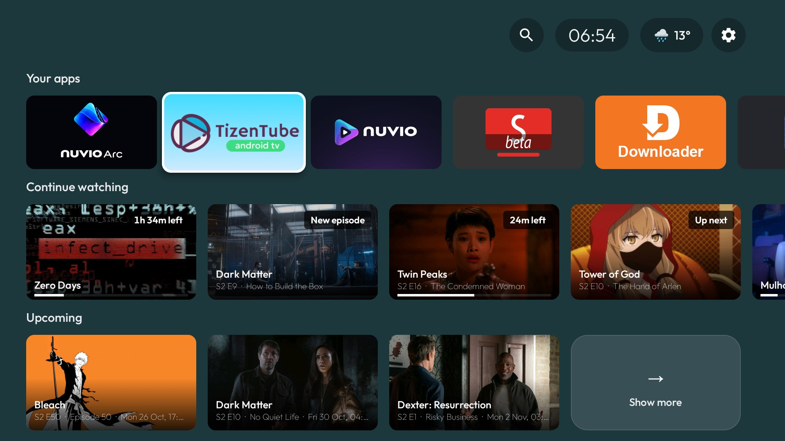

</div>

## Contents

- [Features](#features)
- [Screenshots](#screenshots)
- [Requirements](#requirements)
- [Install](#install)
- [Set up](#set-up)
- [Remote buttons and voice](#remote-buttons-and-voice)
- [Build from source](#build-from-source)
- [Roadmap](#roadmap)
- [Credits](#credits)
- [License](#license)

## Features

**Home**
- A hero for the focused title: clear logo, year, genres, age rating, ratings from IMDb, Trakt, TMDB, Rotten Tomatoes
  and more, and the full synopsis, which scrolls slowly when it is long.
- Continue Watching with time left (`23m left`), `New episode` and `Up next` badges.
- Upcoming episodes of the shows you follow, with a live countdown before they air (style and timing configurable).
- Content rows: trending, popular, box office, most watched, most anticipated, popular lists, and Airing tonight.
- Your apps, with the ones you choose first.
- Checkmarks on everything you have watched; Hide watched in every grid.
- Your own ratings in the corner of every poster, season and episode, as the old Trakt website showed them: a folded
  corner from grey (1) to red (10), from Trakt, Simkl or MDBList.
- Clock and weather (automatic location or a town you choose); both can be hidden.
- The buttons in the top bar adapt to the picture behind them, so they stay readable on bright artwork.
- Everything next to the focused card is fetched ahead, so artwork, logos and ratings appear instantly.

**OK and hold OK**
- OK on a movie or show opens its page; Continue Watching and Upcoming cards resume or play.
- Hold OK on any movie, show or episode opens a menu: Play or Resume, Details, Rate (1-10), Add to a list (your
  Watchlist and lists from Trakt or MDBList, or Simkl's status lists), and Trailer.

**Details pages**
- Play or Resume (`Resume S02E05`) straight in your player, and a Trailer button.
- Seasons and episodes with watched checkmarks and progress, cast, and related titles that preview in the header.
- A season ratings chart: every episode's IMDb rating, coloured from weak to great.

**Grids**
- Show more on any row opens a full grid, with filters: hide watched, several genres, single years or a range, and sort.

**Tracking**
- Trakt, Simkl, MDBList or your Nuvio account, chosen in Settings, like in Nuvio.
- A calendar of upcoming episodes, and new-episode notifications.

**Settings**
- Row order and visibility, the row focused when the TV starts, player app, trailer app, remote buttons, tracking
  provider, weather, and API keys entered from your phone with a QR code.

## Screenshots

| | |
|---|---|
| 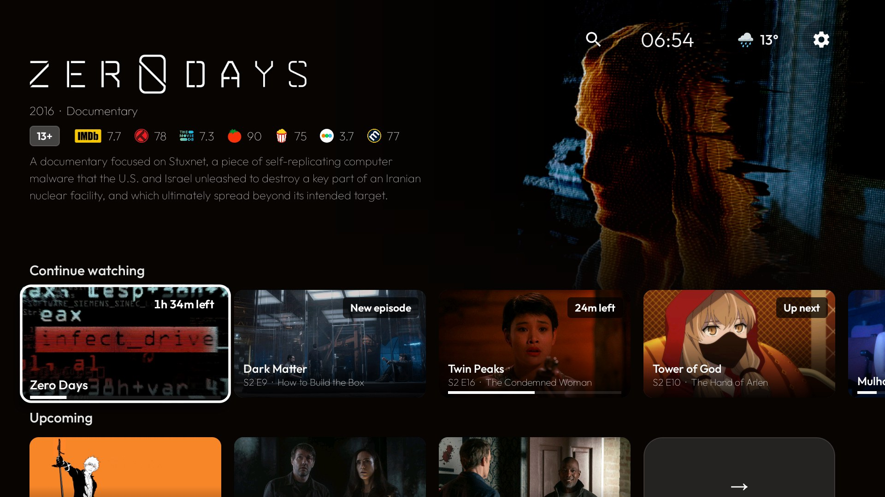 | 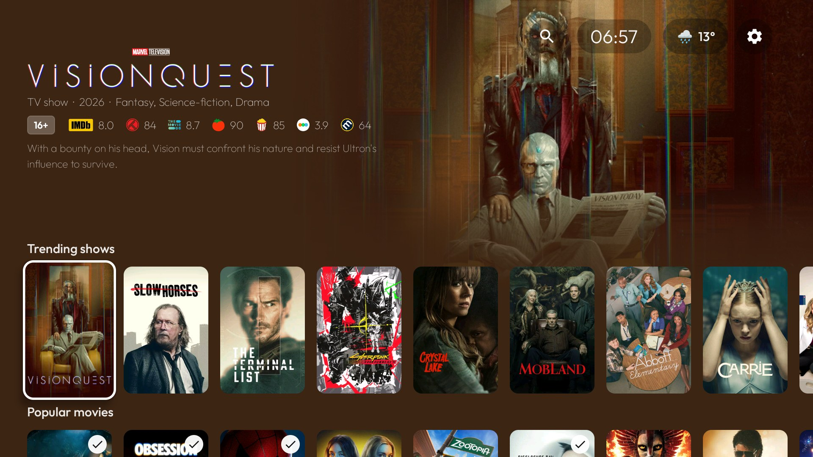 |
| 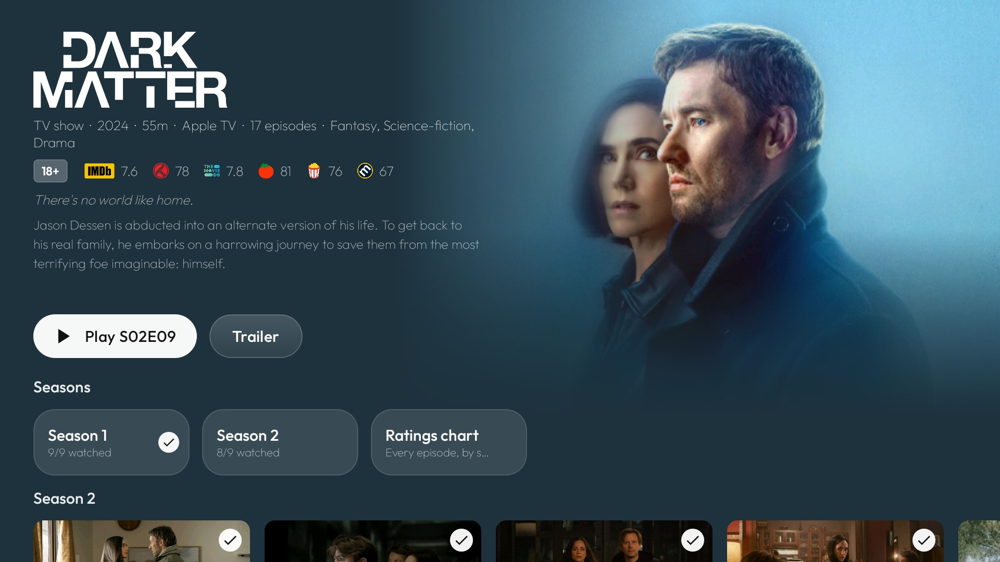 | 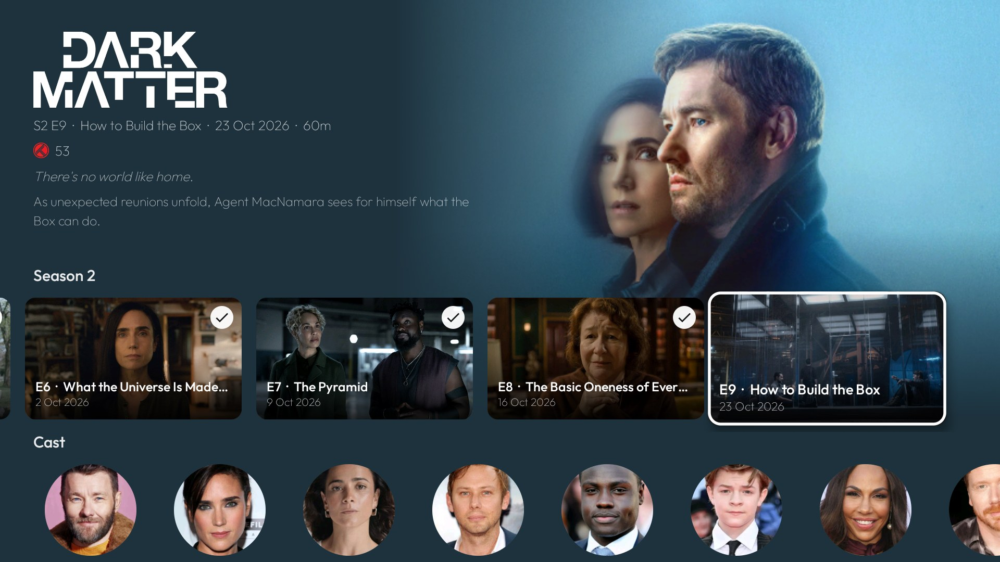 |
| 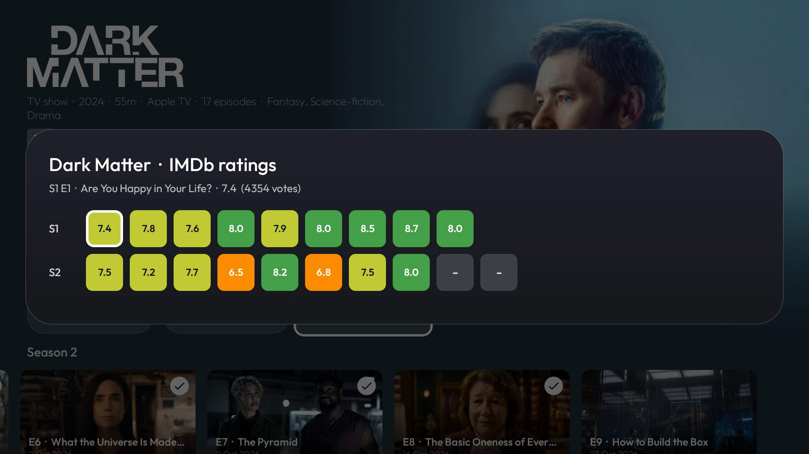 | 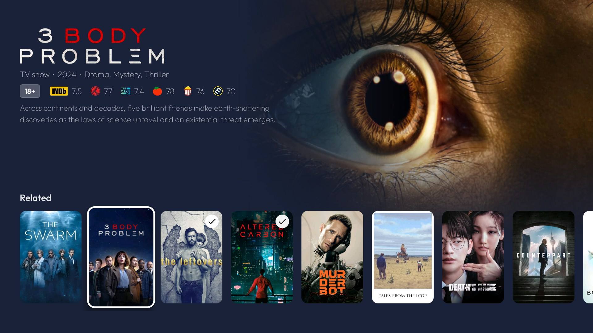 |
| 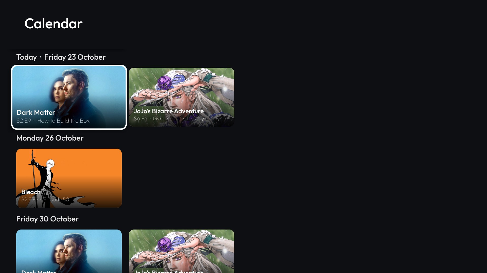 | 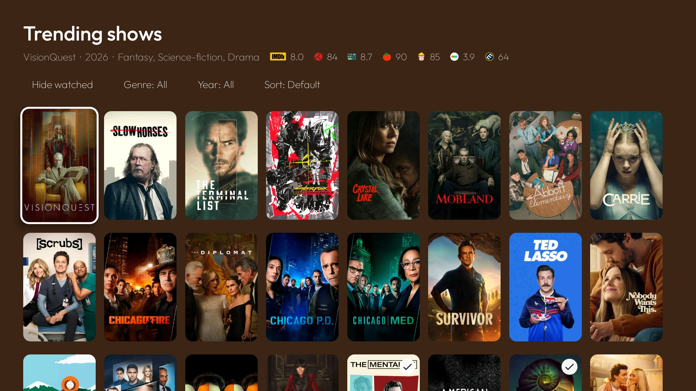 |
| 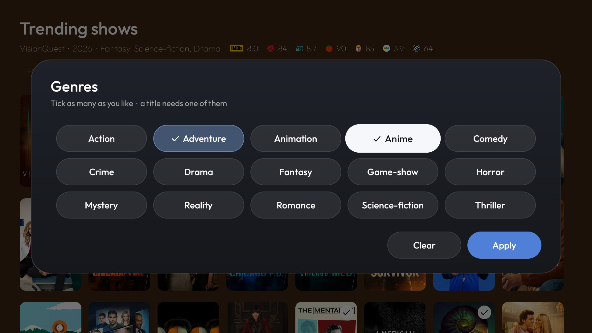 | 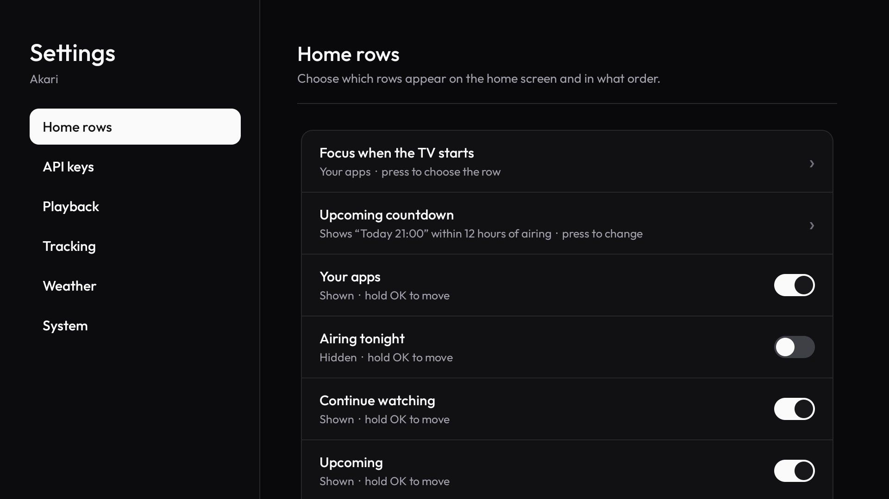 |
| 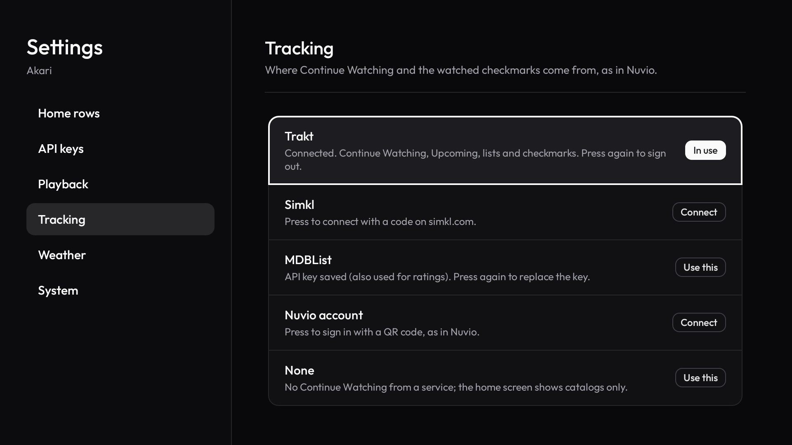 | 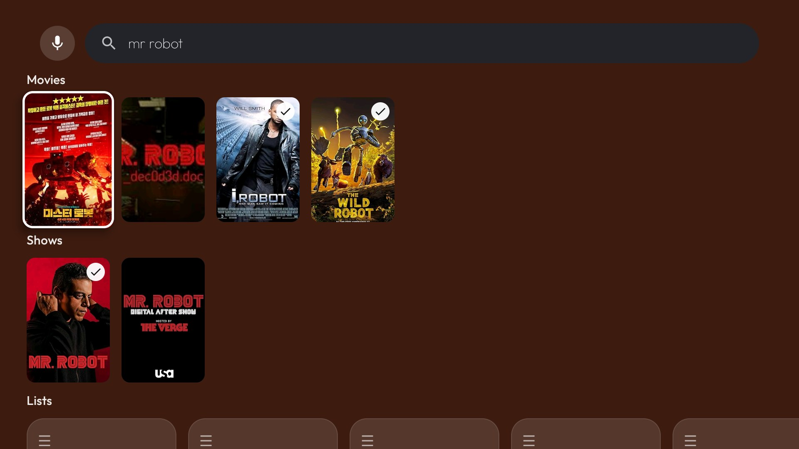 |

## Requirements

- Android TV or Google TV, Android 8.0 or newer.
- A player app that opens titles: [Nuvio](https://github.com/NuvioMedia/NuvioTV) for now (see [Roadmap](#roadmap)).
- Optional: a free account and API key for each service you want (Trakt, Simkl or MDBList for tracking; TMDB, OMDb and
  MDBList for artwork and ratings).

## Install

1. Download `Akari-x.y.z.apk` from the [latest release](../../releases/latest).
2. Install it on the TV, for example with the Downloader app, a file manager, or from a computer:

   ```sh
   adb connect <tv-ip>
   adb install Akari-0.1.3.apk
   ```

3. Make it the home screen. Android TV usually asks which home app to use the next time you press Home. Google TV does
   not, so set it once from a computer:

   ```sh
   adb shell cmd package set-home-activity com.konvar.tvhome/.MainActivity
   ```

   To go back to the stock home screen, run the same command with the stock launcher's package, or uninstall Akari.

4. Optional, from a computer:

   ```sh
   # Continue Watching from apps that publish it to Android TV's "Watch next"
   adb shell pm grant com.konvar.tvhome android.permission.READ_TV_LISTINGS
   # New-episode notifications (Android 13+)
   adb shell pm grant com.konvar.tvhome android.permission.POST_NOTIFICATIONS
   ```

## Set up

Open **Settings** (the gear at the top right of Home).

1. **API keys.** Each key is typed on your phone: scan the QR code, paste the key, done. Keys stay on the TV.
   - **TMDB** (free, [themoviedb.org](https://www.themoviedb.org/settings/api)): backdrops, episode stills, age ratings, trailers.
   - **MDBList** (free, [mdblist.com](https://mdblist.com/preferences/)): the ratings row, and MDBList tracking.
   - **OMDb** (free, [omdbapi.com](https://www.omdbapi.com/apikey.aspx)): IMDb ratings of episodes.
   - **Trakt app** and **Simkl app**: release builds have no built-in Trakt or Simkl app. Create your own (free) and enter
     its IDs here:
     - Trakt: [trakt.tv/oauth/applications](https://trakt.tv/oauth/applications), redirect URI `urn:ietf:wg:oauth:2.0:oob`.
       Enter the Client ID and Client Secret.
     - Simkl: [simkl.com/settings/developer](https://simkl.com/settings/developer). Enter the Client ID.
2. **Tracking.** Choose where Continue Watching and the checkmarks come from, and sign in with the code shown on screen.
3. **Playback.** Pick the player app, the trailer app, and the remote buttons.
4. **Home rows.** Show, hide and reorder the rows (hold OK to move one), and pick the row focused when the TV starts.

## Remote buttons and voice

Remote buttons (such as Netflix or YouTube keys) and "play …" voice requests are handled by Akari's accessibility
service. Enable it once in the TV's Settings → Accessibility → Akari, or from a computer:

```sh
adb shell settings put secure enabled_accessibility_services com.konvar.tvhome/.InputKeyService
adb shell settings put secure accessibility_enabled 1
```

Then choose what each button opens in **Settings → Playback → Remote buttons**: the player app, a YouTube app, any app,
or nothing. **Add a remote button** sets up any other key.

## Build from source

Requirements: JDK 17 and the Android SDK (Android Studio includes both).

```sh
git clone https://github.com/konvar/Akari.git
cd Akari
./gradlew assembleRelease
```

The APK is in `app/build/outputs/apk/release/`. Without a signing key, local builds are signed with the debug key.

Optional: put your own app IDs in `local.properties` (never committed) to build them in, instead of entering them in
Settings:

```properties
TRAKT_CLIENT_ID=...
TRAKT_CLIENT_SECRET=...
SIMKL_CLIENT_ID=...
# The Nuvio account option needs Nuvio's sync backend
NUVIO_SUPABASE_URL=...
NUVIO_SUPABASE_ANON_KEY=...
```

Releases are built by GitHub Actions when a `v*` tag is pushed (`.github/workflows/release.yml`).

## Roadmap

- **More player apps.** Akari opens titles in Nuvio today. Support for Stremio and other apps that open movies and shows
  by IMDb or TMDB id is planned, so any of them can be the player.
- Trailers playing muted behind the hero.
- More rows from TMDB: recommendations, collections, networks and streaming services.

## Credits

Akari uses data from [Trakt](https://trakt.tv), [Simkl](https://simkl.com), [MDBList](https://mdblist.com),
[TMDB](https://www.themoviedb.org), [OMDb](https://www.omdbapi.com), [Cinemeta](https://v3-cinemeta.strem.io),
[Metahub](https://images.metahub.space), [TVmaze](https://www.tvmaze.com), [SeriesGraph](https://seriesgraph.com),
[Open-Meteo](https://open-meteo.com) and [ipwho.is](https://ipwho.is). This product uses the TMDB API but is not endorsed
or certified by TMDB. Akari is not affiliated with any of these services, nor with Nuvio or Google.

Design inspired by Google TV and [Nuvio](https://github.com/NuvioMedia/NuvioTV). The rating logos come from Nuvio and belong
to their owners. Font: [Outfit](https://fonts.google.com/specimen/Outfit), under the SIL Open Font License
(`FONT-LICENSE-OFL.txt`).

## License

[GNU General Public License v3.0](LICENSE).
